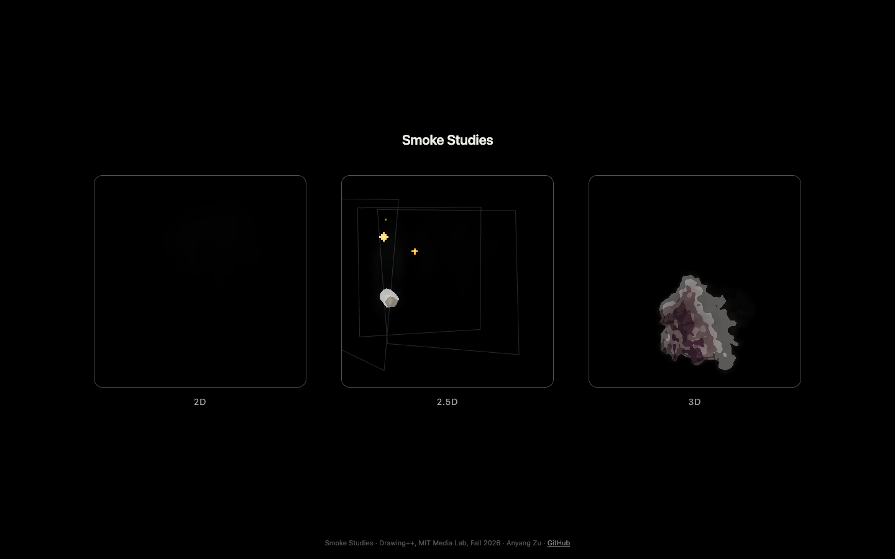
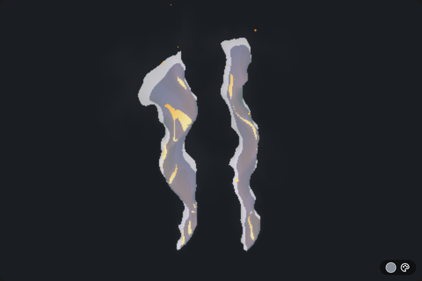
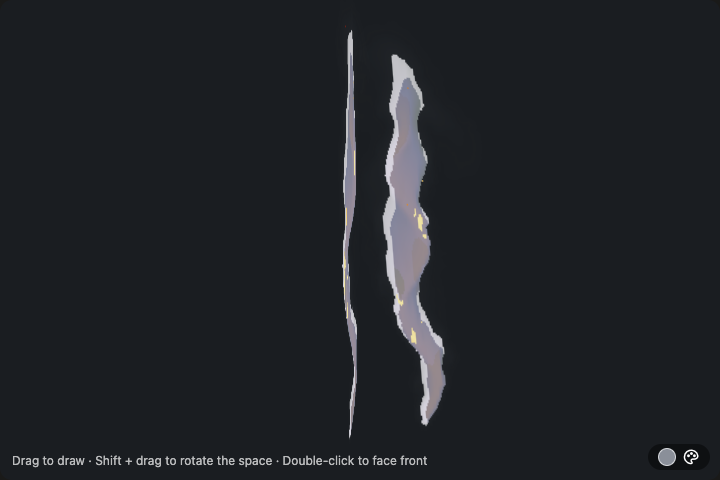
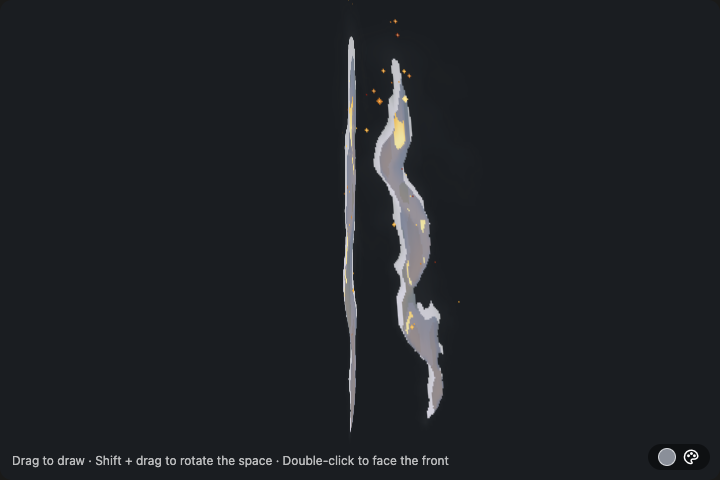
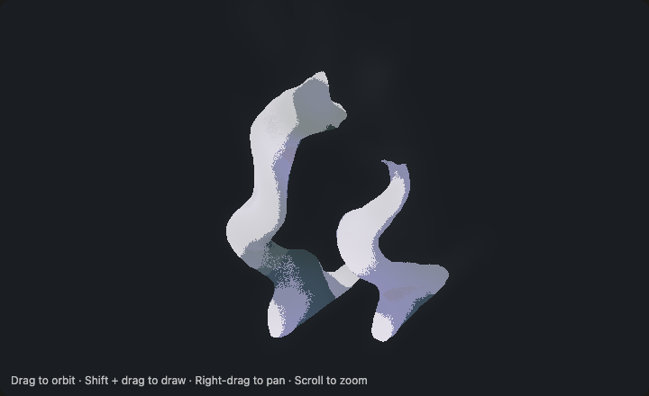
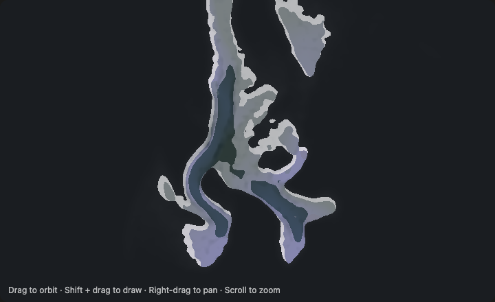
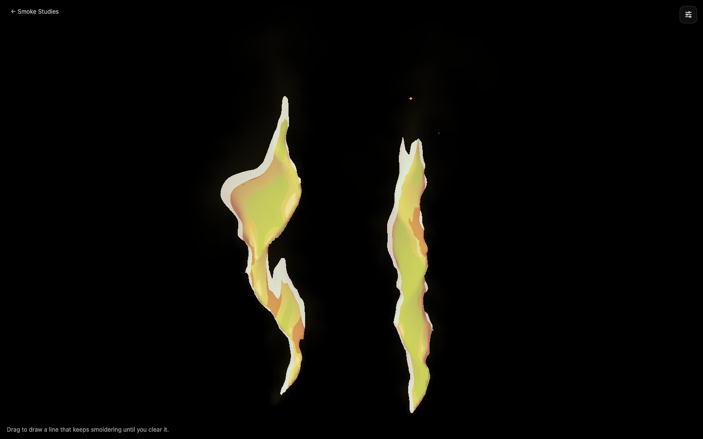
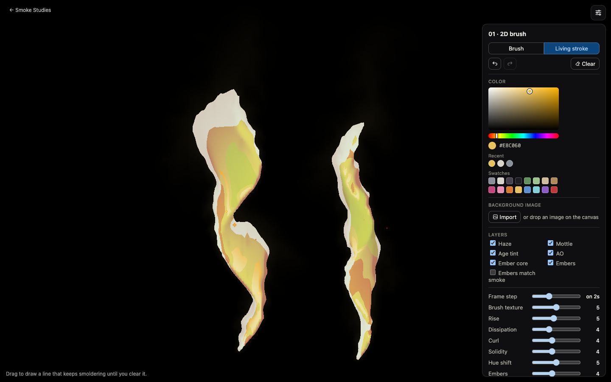
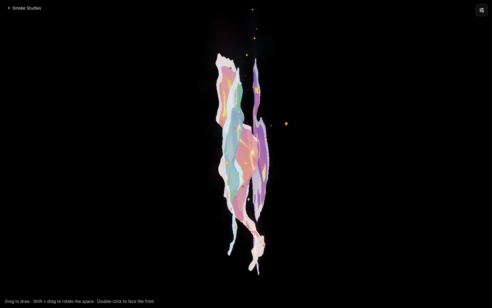
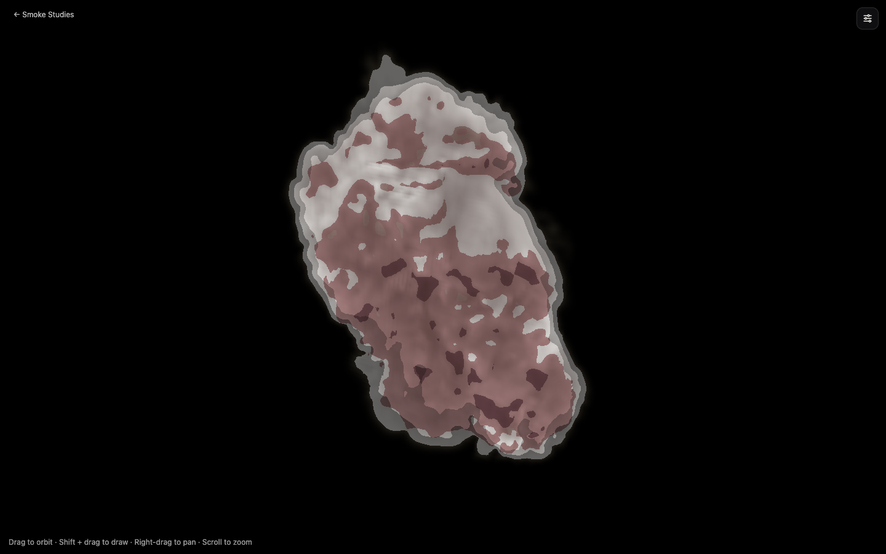

# Smoke Studies: Work Progress

**Assignment:** Create a code-based generative drawing that models something in nature.
**Course:** Drawing++, MIT Media Lab, Fall 2026 (Zach Lieberman)
**Author:** Anyang Zu
**Live demo:** https://zuanyang0809-droid.github.io/smoke-studies/
**Source:** https://github.com/zuanyang0809-droid/smoke-studies

---

## 1. The idea

I chose smoke. Real smoke is a fluid, but smoke in hand-drawn animation, especially Fortiche's work on *Arcane*, is a drawing: a few flat tones, a clear silhouette, shapes that hold for two frames and then jump. I wanted a tool where you **draw the path** and the smoke grows along it and behaves like a fluid, but **renders like a drawing**.

The question I kept asking: *what are the rules an animator follows when drawing smoke, and can a simulation follow the same rules?*

## 2. Research

**Looking at frames.** I stepped through stylized smoke shots frame by frame and wrote down what the drawings do, not what real smoke does. (The frames I studied are not included in the repo.)

| Observation in the hand-drawn smoke | Rule in the code |
| --- | --- |
| A hard outer silhouette, no soft gradient edge | density threshold (0.11) becomes the shape |
| 2 to 3 flat tone bands, light from one side | shadow band from a light-offset occlusion test (threshold 0.42) |
| Shadows shift in hue, not only darken | `makePal` builds a hue-shifted palette from one color |
| Old smoke gets thinner and cooler | an **age** field drives dissipation and an age tint |
| Animated "on 2s" | frame step: the shading only updates every second frame |
| Paint texture inside the shape | a brush-noise texture field that the flow carries along |
| Small drifting embers, not sparks | embers born in fresh smoke, drifting with it |

**Papers.**
- Jos Stam, *Stable Fluids* (1999): the solver (semi-Lagrangian advection, pressure projection).
- Fedkiw, Stam, Jensen, *Visual Simulation of Smoke* (2001): vorticity confinement, which keeps the curls.
- Xie et al., *DualSmoke: Sketch-Based Smoke Illustration Design*: closest related work. It also starts from a sketch, but generates a smoke image with a learned model. I wanted a live simulation you keep drawing into.
- Kim et al., *Transport-Based Neural Style Transfer for Smoke Simulations*: stylizes smoke after simulation. My approach puts the style rules into the renderer instead, so it runs in real time.

## 3. Iterations

### v1 to v9: finding the motion (sketches in conversation)

| Problem | What I changed |
| --- | --- |
| First version was a cluster of outlined balls; it read as bubbles | drop per-ball outlines; rebuild as a real fluid grid with an advected texture |
| Smoke did not rise | buoyancy from *presence* of smoke, not its density, plus drag and slower dissipation |
| Drawing an S-curve, everything piled up at the top of the canvas | `hold()` refills the stroke's target shape while it is alive; the age field lets old smoke fade where it is |
| Sparks splashed outward and felt like fireworks | replaced with slow embers born inside fresh smoke |

### v10: the 2D brush

The first version that felt like *drawing smoke*. Two modes: **Brush** (smoke drifts away) and **Living stroke** (the line keeps smoldering until you clear it). A palette with recent colors, swatches and saved effects.

### v11 to v15: 2.5D cards

Instead of one 3D volume, each stroke lives on a flat **card** in 3D space: a 2D fluid layer you can rotate around (Shift + drag), then draw again on a new plane. This kept the 2D look that worked, while giving depth.

- v11: transparent canvas over a fixed background, CSS tilt
- v12: multiple cards in one space
- v13: removed plane guides, added *Recolor all* vs *Next stroke only*
- v14: adaptive scheduling (each card steps by elapsed time, so many cards stay smooth)
- v15: simulate and redraw only each card's bounding box (fixed the lag in v14)

| v12 | v15 |
| --- | --- |
|  |  |

### 3D v1 and v2

- **v1, volume:** particles splatted into a voxel grid and ray-marched. The first bounded box acted like a frame you could not draw outside of, so I made the space unbounded.
- **v2, screen-space:** particles projected to a 2D grid and shaded with exactly the same toon rules as 2D.

Both looked more like **liquid** than smoke: the shading was too solid and the shapes too smooth. I wrote a separate research note on why: [3d-smoke-research.md](3d-smoke-research.md).

| 3D v1 (volume) | 3D v2 (screen-space) |
| --- | --- |
|  |  |

## 4. Final version

I restructured the single-file prototypes into a modular project (Vite, plain JavaScript modules, WebGL), deployed with GitHub Pages.

- **2D** and **2.5D** shading now runs on the GPU (a GLSL port of the CPU renderer).
- **3D** has a new GPU smoke fluid (64 × 80 × 64) ray-marched as translucent, banded layers. Each puff fades at its own height instead of collecting at the top.
- Every study: full-window canvas, a collapsible side panel (it opens on load, then slides away to show it is there), undo / redo (Ctrl/Cmd + Z, Ctrl/Cmd + R), a background photo to paint smoke over, and black as the default background.
- All look settings are stored in one **Style JSON** (`smoke-style/1`, values 0..1), so the same style can drive the 2D, 2.5D and 3D renderers.
- **97 tests**, including parity tests that run the archived prototypes next to the new modules and require bit-identical output.

### 2D brush

| Living strokes | With the control panel |
| --- | --- |
|  |  |

### 2.5D cards

Three strokes on three planes, each in its own color (*Next stroke only*), seen from a rotated view.

### 3D volume

## 5. What I learned

- **Style is a set of rules, not a filter.** The hand-drawn look came from a few explicit rules (threshold, bands, hue shift, frame step). Writing them down made them adjustable, and they now live in one Style JSON.
- **The motion matters more than the shading.** Most iterations fixed *how smoke moves* (rising, holding the stroke, fading with age). The look only worked once the motion was right.
- **2.5D beat full 3D.** Flat cards in space kept the drawn quality; the true 3D versions kept drifting toward "liquid".
- **Performance shapes the design.** Simulating only what is on screen (bounding boxes, dirty rectangles) and moving shading to the GPU is what made many strokes possible.

## 6. Next steps

- Let artists save and share their own styles (a personal "smoke hand").
- Push the 3D fluid further toward wispy, broken edges.
- Export: image sequences or a VFX add-on so the smoke can be used over film frames and animation.
- A short paper: the rule set, comparison with DualSmoke and neural style transfer, and a small user study.
